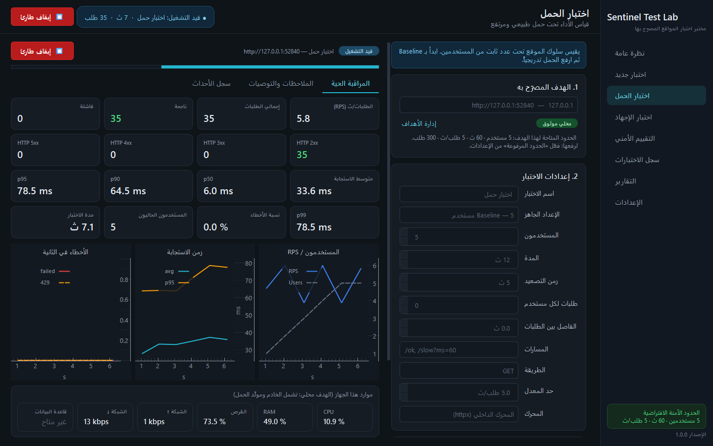

# Sentinel Test Lab

تطبيق سطح مكتب (Windows) لاختبار **مواقعك ومشاريعك الخاصة**: أداء، تحمّل، وإعدادات أمنية — بواجهة عربية
ومحرك أمان يمنع استخدامه ضد أي هدف لم تصرّح به.



## التشغيل السريع

بعد البناء (انظر «للمطوّرين») شغّل:

```
dist\SentinelTestLab\SentinelTestLab.exe
```

من الكود المصدري: `.venv\Scripts\python.exe run_sentinel.py` — التفاصيل في [docs/INSTALL.md](docs/INSTALL.md).

## كيف يعمل

1. **اختبار جديد**: اكتب عنوان موقعك (أو اختره من القائمة)، واختر من القوائم: علاقتك بالموقع، النطاق، نوع الاختبار.
2. ضع علامة تأكيد الملكية واضغط **«فحص وتشغيل»**: التطبيق يفحص الهدف، يحفظه، ويبدأ الاختبار بالإعدادات الآمنة.
3. **راقب**: مقاييس ورسوم حية، وزر إيقاف طارئ دائماً أمامك.
4. **التقرير**: PDF / HTML / JSON / CSV مع ملخص وتوصيات.

لتعديل الإعدادات يدوياً استخدم صفحات الاختبارات مباشرةً؛ التطبيق يشرح لحظياً ما سيُرسَل أو لماذا لا يمكن البدء.

## أنواع الاختبارات

| الصفحة | الاختبار | ماذا يجيب |
|---|---|---|
| اختبار الحمل | Load | كيف يتصرف الموقع تحت عدد ثابت من المستخدمين؟ |
| اختبار الإجهاد | Stress | عند أي مستوى يبدأ الأداء بالتدهور؟ |
| | Spike | هل يتعافى الموقع بعد قفزة مفاجئة؟ |
| | HTTP Flood Resilience | هل تحديد المعدل (429) يعمل؟ |
| التقييم الأمني | الثغرات والإعدادات | ترويسات الأمان، TLS، الكوكيز، CSRF، أسرار ظاهرة، مكتبات قديمة، ملفات ولوحات مكشوفة، XSS / SQL Injection / Open Redirect (كشف فقط) — مع تصنيف CWE و OWASP Top 10 ومؤشر A–F |
| | الجاهزية ضد DDoS | هل يوجد CDN/WAF وكاش؟ هل الخادم الأصلي مكشوف؟ |
| | الحماية من Brute Force | هل يُقفل الحساب أو يُقيَّد بعد محاولات فاشلة؟ |

## الأمان

- الحدود الافتراضية: **5 مستخدمين · 60 ثانية · 5 طلب/ث**.
- رفعها يتطلب هدفاً محلياً أو موثّق الملكية + تفعيلاً من الإعدادات + كتابة اسم المضيف.
- سقف مطلق في الكود: 200 مستخدم · 900 ث · 200 طلب/ث.
- إيقاف تلقائي عند عدم استقرار الهدف، وسجل تدقيق لكل عملية.

اقرأ [docs/SAFETY.md](docs/SAFETY.md) قبل أول اختبار على موقع إنتاج.

## الأدوات المتكاملة

| الأداة | الحالة |
|---|---|
| المحرك الداخلي (httpx) | مدمج، يعمل دائماً |
| k6 2.4.0 | مثبت ومُختبَر فعلياً |
| OWASP ZAP 2.17.0 | مثبت ومُختبَر فعلياً؛ يُشغَّل تلقائياً عند اختيار فحص ZAP |
| Locust | مُختبَر فعلياً (من الكود المصدري) |
| Docker (`docker stats`) | مُختبَر فعلياً محلياً؛ عبر SSH غير مُجرَّب على خادم حقيقي |
| Cloudflare API | مبني، لم يُجرَّب على حساب حقيقي (يحتاج token) |

## ما يجب معرفته

- لم يُجرَّب التطبيق على موقع حقيقي على الإنترنت بعد؛ كل الاختبارات كانت على خادم محلي.
- موارد الخادم تُقرأ من حاوية Docker (محلياً أو عبر SSH) إن حدّدتها في الإعدادات؛ مقاييس قاعدة البيانات **غير متاحة**.
- مراقبة الحاوية عبر SSH لم تُجرَّب على خادم بعيد حقيقي بعد (المحلية مُختبَرة).
- فحص ZAP النشط يرسل طلبات إلى الموقع كله، لذلك يتطلب هدفاً موثوقاً نطاقه كل الموقع.
- التقييم الأمني سطحي وغير اقتحامي، ولا يغني عن اختبار اختراق احترافي.

القائمة الكاملة: [docs/CAPABILITIES.md](docs/CAPABILITIES.md).

## الوثائق

| الملف | المحتوى |
|---|---|
| [docs/INSTALL.md](docs/INSTALL.md) | التثبيت، التجربة الأولى، التكاملات، البناء |
| [docs/SAFETY.md](docs/SAFETY.md) | محرك الأمان والاستخدام المسؤول |
| [docs/CAPABILITIES.md](docs/CAPABILITIES.md) | المدعوم وغير المدعوم |
| [docs/TEST_RESULTS.md](docs/TEST_RESULTS.md) | نتائج الاختبارات (237 ناجحة) |
| [docs/ARCHITECTURE.md](docs/ARCHITECTURE.md) | بنية الكود وكيفية التوسعة |
| [docs/ROADMAP.md](docs/ROADMAP.md) | خطة التطوير المستقبلية (تخطيط فقط) |
| [examples/](examples/) | تقارير مثال من اختبارات محلية حقيقية |

## بنية المشروع

```
sentinel_test_lab/   الكود: app, core, engines, integrations, monitoring, reporting, database, ui
tests/               237 اختباراً + خوادم الاختبار المحلية
scripts/             توليد التقارير المثال، لقطات الواجهة، الأيقونة
docs/                الوثائق واللقطات
examples/            تقارير مثال (PDF/HTML/JSON/CSV)
dist/SentinelTestLab الملف التنفيذي
sentinel.spec        تعريف البناء (PyInstaller)
```

## للمطوّرين

```powershell
.venv\Scripts\python.exe -m pytest tests -q            # الاختبارات
.venv\Scripts\python.exe -m tests.support.local_server # خادم تجريبي محلي
.venv\Scriptspython.exe -m PyInstaller sentinel.spec --noconfirm # بناء الـ exe
```
